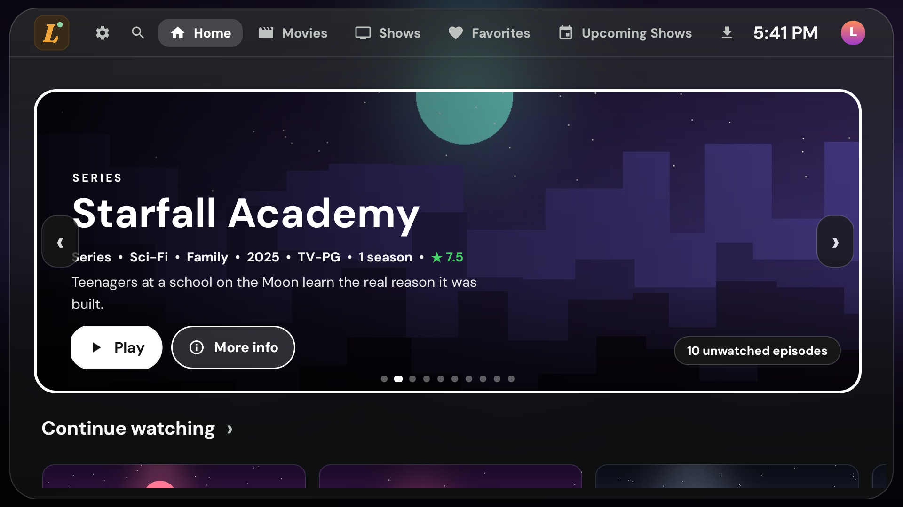
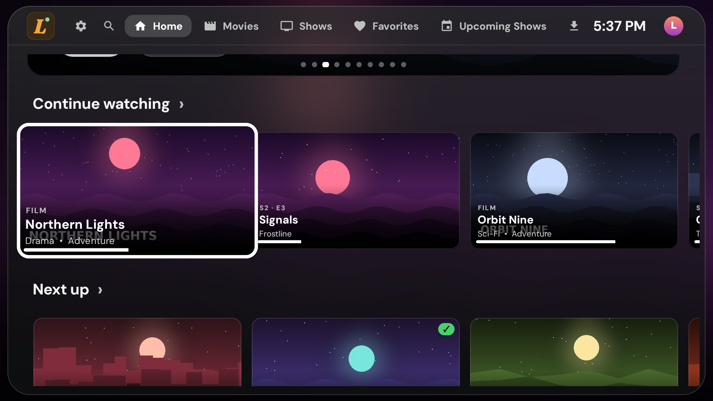
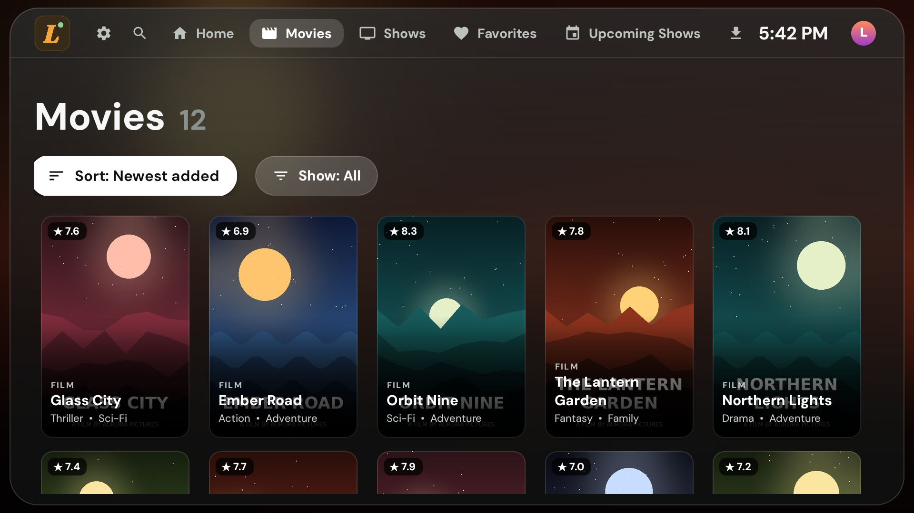
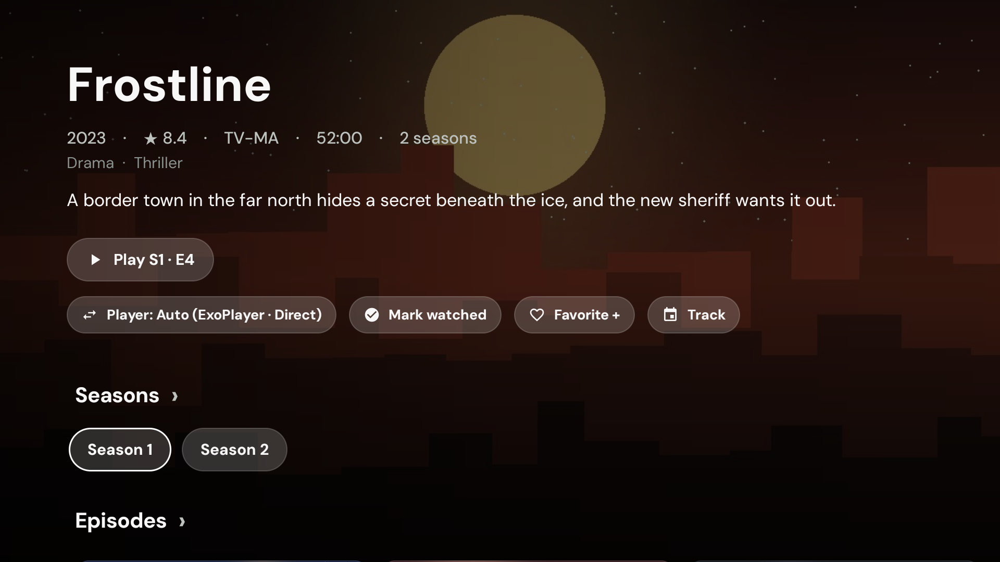
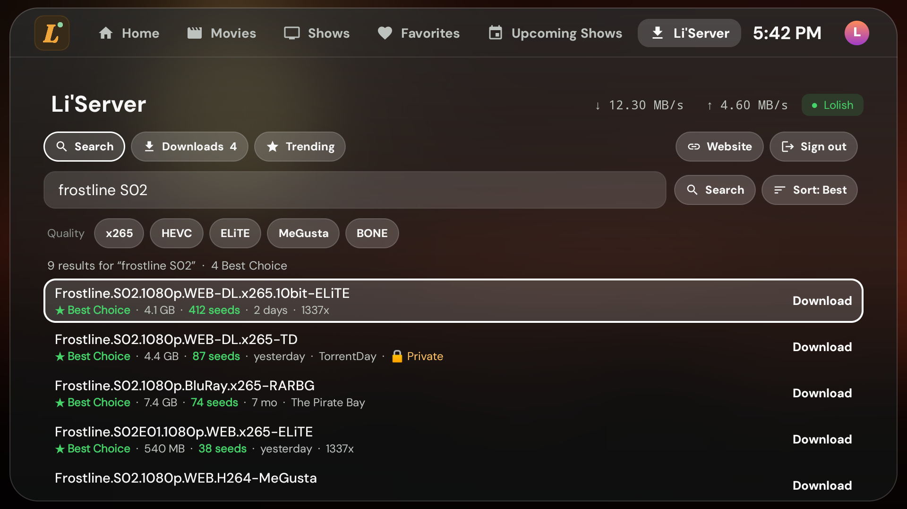
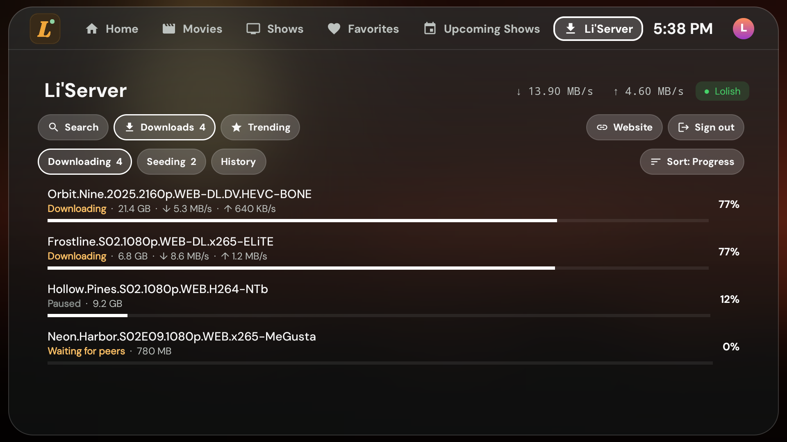
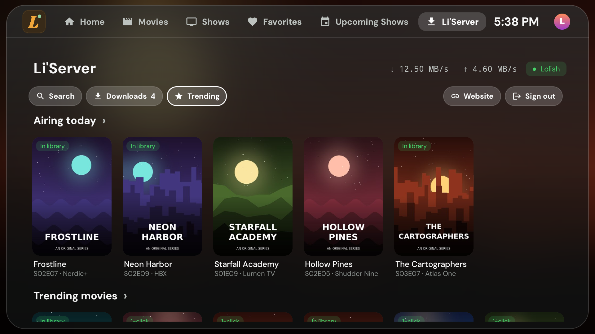
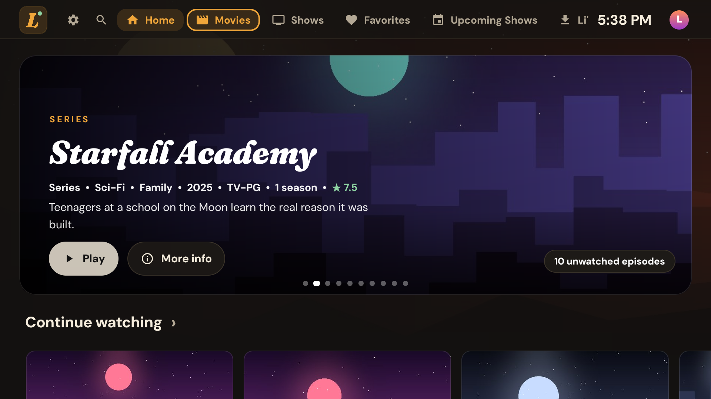
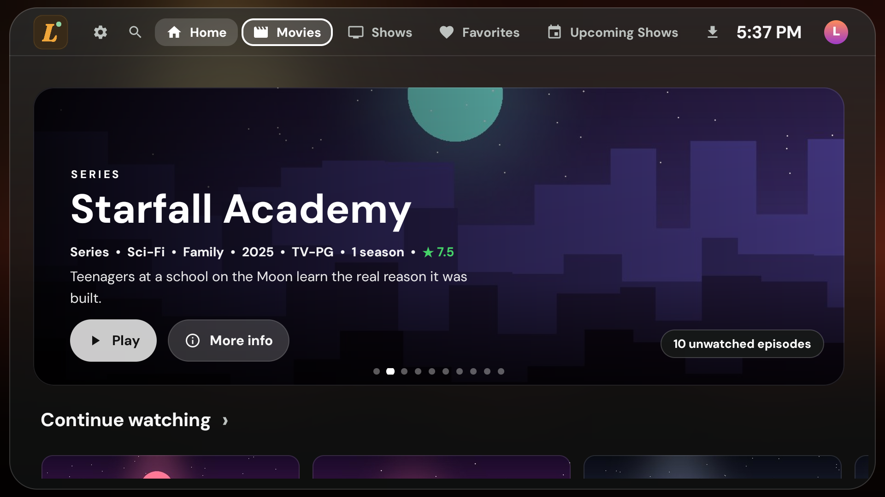
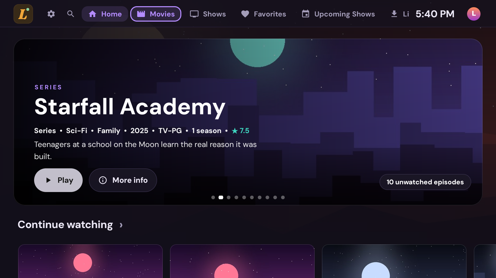

# Lolish's Project

An **Android TV app** for watching your **Jellyfin** library and managing downloads on **Li'Server**, all with the TV remote.

It has three parts that work together:

1. **A Jellyfin client.** Browse movies and shows the way you do in a streaming app: a big banner, rows of new titles, previews that start by themselves, a page for every film and show.
2. **A built-in player.** ExoPlayer and VLC in one player that you can switch between while watching, with subtitles you can download straight from the internet.
3. **Li'Server, the torrent part.** Search, download and follow your torrents on the Li'Server download server. New films and episodes go straight into the right Jellyfin library folder.

It is set up for the Lolish server (`http://lolish.no-ip.com:8096`), but works with any Jellyfin server.

## Screenshots

<table>
<tr>
<td width="50%"> <b>Home:</b> Continue watching, Next up and more</td>
<td width="50%"> <b>Library:</b> newest added first, sort and filter</td>
</tr>
<tr>
<td> <b>Title page:</b> play, player choice, watched, favorite, Track, seasons</td>
<td> <b>Li'Server search:</b> ★ Best Choice, seeds, private trackers</td>
</tr>
<tr>
<td> <b>Li'Server downloads:</b> progress and speeds</td>
<td> <b>Li'Server trending:</b> airing today and trending movies</td>
</tr>
</table>

**Three themes:** Lolish amber, Glass and Li'Server purple.

<table>
<tr>
<td width="33%"> Lolish amber</td>
<td width="33%"> Glass</td>
<td width="33%"> Li'Server purple</td>
</tr>
</table>

The screenshots come from the real app on an Android TV emulator, connected to a test server with made-up titles and artwork.

---

## Getting started

### Install

1. Open **Releases** on this page and download the newest APK:
   - `…-jellyfin-release.apk`: **the one to use.** The official Jellyfin app can also pick it as its *external player*.
   - `…-standalone-release.apk`: the same app under its own name, so it can sit next to the other one.
2. Install it on the TV with a file manager, *Downloader* or `adb install`. Allow *Install unknown apps* when Android asks.

### Sign in

- **Servers:** the Lolish server is already filled in. Use **Servers** to switch to another server or add one.
  - Typing just the address is enough, for example `lolish.no-ip.com`. The app tries https and http on the usual Jellyfin ports and uses the one that answers.
- **Who's watching?** Pick your profile, use **Quick Connect** (approve the code from your phone or computer), or type your username and password.
- **Several people on one TV:** everyone signed in on the TV gets a profile picture on the start screen. Each profile keeps its own:
  - theme, menu, icons and sizes
  - tracked shows
  - Li'Server login

### Updates

- The app checks this GitHub page for new versions and shows what changed before you update.
- **Older versions** (at the top of Settings) reinstalls one of the two previous versions if a new one doesn't suit you.

---

## The Jellyfin part

### Menu and looks

- **Menu on top or on the left side.** Hold **OK** on a menu item to:
  - move it
  - hide it
  - give it another icon (every library gets its own icon automatically)
  - show hidden items again
- **Only what you keep in the menu shows up.** Hide a library and it also disappears from Home.
- **Three themes:**
  - Lolish amber
  - Glass (a frosted pane over the artwork)
  - Li'Server purple
- **Sizes you can change:**
  - posters
  - wide tiles
  - icons
  - text
  - menu size
  - how much the selected card grows
- **A clock** in the top corner of the menus (never while you watch).
- **BACK always goes back to Home first.** On Home it asks before closing the app.

### Home

- **Banner:** 10 new titles from your libraries, picked at random and changed every day.
  - Move between them with ◀ ▶. They also turn by themselves every 10 seconds.
  - Stay on one and its trailer starts inside the banner.
- **Rows:**
  - **New episodes for you:** shows you follow that got a new episode
  - **Continue watching**
  - **Next up**
  - **Latest** for each library
  - **Upcoming**
  - **Favorites**
- **Welcome card:** when a new episode of a show you follow arrives, Home greets you with *Welcome back, Name* and the new episodes. OK plays one.
- **Previews:**
  - Stay on any movie or show for 3 seconds and it starts playing in a big window, in the film's own shape, with its name and description.
  - After 20 seconds it carries on in the real player from the same spot.
  - Settings let you turn previews off or keep them as previews only, with or without sound.

### Libraries, search and title pages

- **Libraries:** poster grids with sort (newest added first by default, newest release, name and more) and filters. The choice is remembered for each library.
- **Search, Favorites and Upcoming** have their own pages.
- **Title pages:**
  - poster art, logo, rating, runtime and genres
  - Play / Resume, Start over and which player to use
  - Watched, Favorite, **Track** and a link to the show
  - seasons and episodes, cast, and *More like this*

### Following shows

- **Track** a show on its page, and its new episodes come first on Home.
- **Shows you watch a lot are tracked automatically.** You can switch that off for any show with the same button.
- **Last episode:** about a minute before the end of the newest episode you have, the player shows *Last episode*.
  - It also says when the next one airs, from TVmaze, a free TV schedule site.
  - If the show has ended, it says so.

---

## The player

### Players

- **Switch players while watching**, without losing your place:
  - **ExoPlayer · Direct:** original quality, HDR / Dolby Vision, audio passthrough
  - **VLC · Direct:** plays unusual formats such as AVI and WMV
  - **Converted by the server** at 20, 10 or 4 Mbps, for when the network or the file is the problem
- **Stutter detection:** if the video keeps stopping or dropping frames, the player offers a better choice.
- **It remembers the player that worked** for each film and each show.

### Subtitles and audio

- Every subtitle and audio track shows its real name (Swedish, English…), in both ExoPlayer and VLC.
- **Download subtitles** from the Subtitles menu:
  - Pick a language. 17 are offered and your last choice comes first.
  - Pick a file found on **OpenSubtitles**, **Addic7ed** (TV episodes) or by your Jellyfin server's own subtitle plugins.
  - It turns on straight away.
- Subtitle and audio delay, subtitle size, colour and style.

### Watching

- **Seeking:** ◀ ▶ shows just the timeline, the times and a small picture of where you will land, so you still see the film. Press **OK** for the buttons.
- **Picture:**
  - **Auto** fills the screen from side to side without stretching. 4:3 and other narrow pictures keep their shape.
  - Fit, Zoom and Stretch are there too.
- Skip intro and credits.
- Chapters.
- **Up next** at the end of an episode.
- Switches the TV to the film's frame rate (23.976 / 24 / 25 / 50 / 60 Hz).
- Watched status and resume points are saved to Jellyfin.

The `jellyfin` APK also works as the *external player* of the official Jellyfin Android TV app: in that app choose **Settings › Playback › Video player › External app**.

---

## Li'Server: the torrent part

Li'Server is the Lolish download server: a torrent client with a search engine, seeding rules and folders that match the Jellyfin libraries. Open it from **Li'Server** in the menu.

**Settings › Li'Server › Open Li'Server as** chooses between two ways of using it:

- **TV screen** (made for the remote): Search, Downloads and Trending, described below.
- **Website:** the full Li'Server website inside the app.
  - The remote moves a pointer: the arrows move it, **OK** clicks, and pushing against an edge scrolls.
  - **Menu** switches between pointer and normal focus.
  - Page zoom is adjustable.

**Sign in:** each profile signs in with its own Li'Server account the first time. The login is saved for that profile only, encrypted on the TV, and nobody else on the TV sees it.

### Search

- Type a title, optionally with a season (`S01`) or a quality tag. Public and private trackers are always searched together.
- **Quality chips** add common tags to the search: x265, HEVC, ELiTE, MeGusta, BONE.
- **Sort results** by Best, Seeds, Size, Newest or Name.
- **★ Best Choice** marks 1080p x265 / HEVC / AV1 releases that have seeders.
- **🔒** marks private-tracker results.
- **Download:**
  1. Pick a result. Li'Server works out where it belongs, for example *TV Shows › Show › Season 2*.
  2. The app shows that folder before you confirm.
  3. After you confirm, it opens Downloads with the new file selected.

### Downloads

- Three tabs:
  - **Downloading**
  - **Seeding**
  - **History**
- Each download shows progress, size, download and upload speed, and seeding progress. Sort by progress, speed or name.
- The total download and upload speed is shown at the top.
- Press OK on a download to:
  - **Pause / Resume / Force start**
  - **Seed longer** or **Stop seeding now**. Private trackers may count stopping early as a hit-and-run, and the app warns you.
  - **Search for other copies** if a download is stuck
  - **Delete**, with its files
- When seeding is done, the file moves into the Jellyfin library by itself.
- **Small speed window:** leave the Li'Server page while something downloads and a small window shows its progress and speed. Press OK on it to hide it.

### Trending

What airs today and what is trending, as tiles. Pick one to search for it straight away.

---

## Settings at a glance

| Section | What's there |
|---|---|
| Top of Settings | **Check for updates**, **Older versions** |
| Users | Switch user, add a user, ask *Who's watching?* at start, remove a user, **Server** |
| Appearance | Theme, menu on top or left, clock, previews and preview sound, Home rows as wide cards or posters, poster size, wide tile size, selected card zoom, icon size, text size, sidebar size and mode, titles and ratings on cards, the big banner, which Home rows to show, animations |
| Playback | Default player, **Picture** (Auto / Fit / Zoom / Stretch), stutter detection, remember the player that works, play the next episode automatically, match frame rate, tunneled playback, seek step, remember subtitle and audio delay per video, VLC passthrough, engine used as external player |
| Subtitles & audio | Show subtitles, preferred subtitle language, full ASS / SSA styling, size, position, style, colour, preferred audio language |
| Li'Server | Open as TV screen or website, address, username, password (stored encrypted), sign in automatically, page zoom, forget the login |

---

## Building

Every push to `main` builds the app with GitHub Actions and publishes a release named `3.0.<build number>`. Each release contains:

- the `jellyfin` and `standalone` APKs
- the two previous versions, rebuilt so that **Older versions** in the app can go back to them
- a `_back` APK the app uses to return to the newest version

The five newest releases are kept.

To build it yourself, open the project in Android Studio, or run `./gradlew assembleJellyfinRelease`.

## Licences

Media3 (Apache 2.0) · Jellyfin media3-ffmpeg-decoder (GPL-3.0) · ass-media (MIT) / libass (ISC) · libVLC (LGPL-2.1) · Fraunces and DM Sans fonts (SIL OFL 1.1, see `FONTS_OFL_*.txt`).

Subtitles are found on OpenSubtitles.org and Addic7ed (through Gestdown); air dates come from TVmaze.
